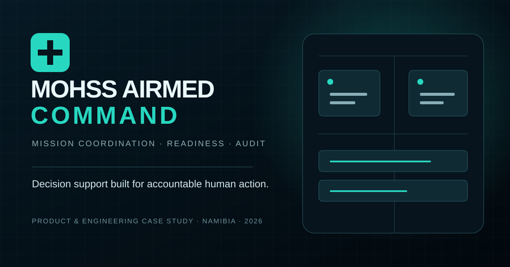

# MOHSS AIRMED COMMAND — Product & Engineering Case Study



**A national air-medical mission coordination concept for Namibia.**

> This is a presentation-safe case study. The operational source, environment configuration, security implementation and deployment architecture remain in a separate private repository.

## My role

**Freeman Ipumbu — Systems designer, design researcher and product engineer**

I translated a high-consequence coordination problem into a coherent command environment spanning mission intake, clinical validation, aircraft and crew readiness, receiving-facility coordination, aviation review, authorization and audit history.

## The problem

Air-medical coordination crosses clinical, aviation and command boundaries. When state, responsibility and release decisions live in disconnected calls or documents, teams can lose time and accountability precisely when both matter most.

The artefact explores one shared operational picture with explicit readiness gates and attributable human decisions.

## Product response

- National command-centre overview for active missions and operational priorities.
- Structured mission intake and controlled lifecycle progression.
- Clinical, aircraft, crew, hospital and aviation readiness gates.
- Human authorization preserved for consequential dispatch decisions.
- Fleet, crew and receiving-facility resource views.
- Correlation-aware errors, optimistic concurrency and attributable audit events.
- Mock and API modes so interface evaluation does not weaken backend boundaries.
- Clear ready, checking and degraded connectivity states.

## Architecture

```text
React + TypeScript command centre
               │
       typed repository adapters
               │
Kotlin / Spring Boot modular API
               │
 PostgreSQL + PostGIS + Flyway
```

The backend follows a modular-monolith approach: operationally simple to deploy, while domain and authorization boundaries remain explicit.

## Engineering stack

- React, TypeScript, React Router and Vite
- Kotlin, Spring Boot and Java 21
- PostgreSQL, PostGIS and Flyway
- Role-restricted backend actions and development RBAC
- Docker Compose for the local data foundation
- Production-shaped health, error and audit contracts

## Design science lens

1. Map the real decision chain and its accountability gaps.
2. Turn hand-offs and readiness conditions into visible system state.
3. Prototype the shared command picture with demonstration data.
4. Build the persistence, lifecycle and authorization foundation.
5. Evaluate failure paths, stale commands and degraded connectivity.
6. Preserve the boundary between decision support and authorized human action.

## Safety boundary

AIRMED COMMAND is a controlled development artefact, not an approved live dispatch or clinical system. It does not autonomously dispatch aircraft, certify airworthiness, override pilots or clinicians, or treat demonstration records as operational data.

Live use would require approved identity federation and MFA, formal clinical and aviation validation, protected health-information controls, hardened infrastructure, disaster recovery, monitoring, security review and institutional acceptance.

## Repository boundary

This public repository excludes deployable application source, credentials, environment files, database configuration, private records and operational infrastructure. Security concerns should be shared privately with the project owner.

---

© 2026 Freeman Ipumbu. Shared for portfolio evaluation; no operational-use licence is granted.
